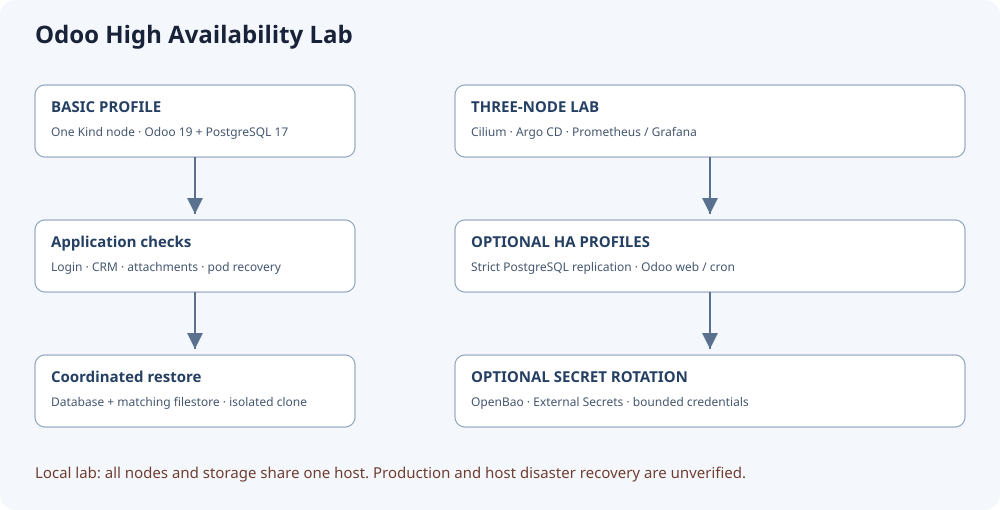
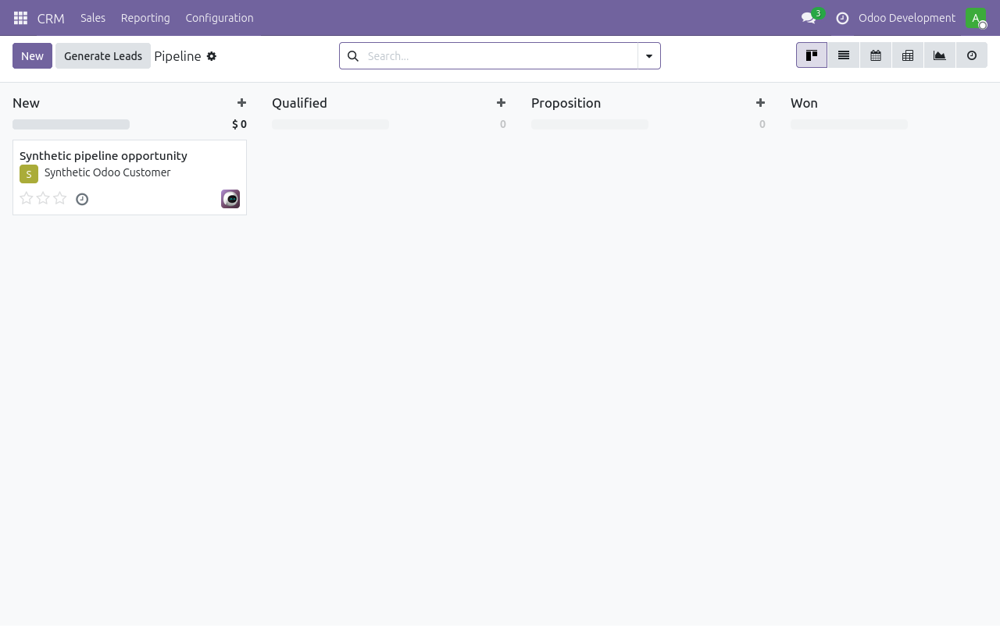

# Odoo High Availability Lab

[](https://github.com/Hatef-Rostamkhani/odoo-high-availability/actions/workflows/ci.yml)
[](LICENSE)

Run Odoo 19 Community and PostgreSQL locally, then explore replication, recovery,
GitOps and secret rotation in a larger Kubernetes lab. This project is for
operators and developers who want executable examples with synthetic CRM data.



**Status: experimental, pre-0.1.0.** The basic profile has real login, CRM,
attachment, pod replacement and isolated database/filestore restore tests. All
Kind nodes in the HA lab share one computer. Physical-host fault tolerance and
production operation are unverified. The [security release gate](docs/security-inventory.md)
is currently blocked by PostgreSQL image findings. See [validation](docs/validation.md).

## Choose a profile

| Profile | Purpose | Supported host and resources |
|---|---|---|
| Basic | One-node Kind, standalone PostgreSQL and Odoo with synthetic data | Ubuntu 24.04 amd64; Docker; 4 GiB available RAM; 8 GiB free disk |
| Three-node lab | Cilium/Hubble, Argo CD, monitoring and optional HA/rotation | Ubuntu 24.04 amd64; at least 12 GiB available RAM and 35 GiB free disk; HA gates may need more |

The basic profile uses Kind's default CNI. Policy enforcement is tested separately
in the Cilium lab. Each profile has its own cluster and private kubeconfig.

## Start the basic profile

Install Docker if necessary using the reviewed [host installation guide](docs/installation.md).
With Docker accessible from your shell:

```bash
git clone https://github.com/Hatef-Rostamkhani/odoo-high-availability.git
cd odoo-high-availability
sudo apt-get update
sudo apt-get install -y --no-install-recommends python3-yaml make curl git
python3 scripts/tools.py --only kind kubectl helm
make basic-up
make basic-status
make basic-forward
```

Open <http://127.0.0.1:8069>. Login is `admin`. Read the value of `odoo-admin`
privately from `.state/odoo-basic/credentials.json`; keep it out of logs and issues.
The company is **Odoo Development** with a synthetic customer, CRM opportunity
and attachment. Stop the foreground localhost forward with Ctrl+C. If port 8069
is occupied, stop the other listener yourself; scripts do not kill unrelated processes.

| Command | Result |
|---|---|
| `make basic-up` | Create or reconcile the owned basic environment |
| `make basic-status` | Inspect its pods, jobs and storage |
| `make basic-forward` | Open a foreground localhost connection to Odoo |
| `make basic-test` | Check login/files, replace pods and test isolated coordinated restore |
| `make basic-down` | Delete the basic cluster, including its data, and its private state |
| `make test-static` | Check formatting, workflows, charts, schemas, contracts and source secrets |
| `make test-ci-integration` | Run the documented basic commands in a temporary cluster and clean up |

The recovery test pauses Odoo and replaces pods. Use development data and expect
a brief interruption. See the [profile guide](docs/profiles.md) for the larger lab
and the [command reference](docs/commands.md) for advanced operations.



Actual basic-profile UI with generated demonstration data; no production data is used.

## Understand and contribute

- [Architecture](docs/architecture.md), [installation](docs/installation.md), [profiles](docs/profiles.md)
- [Testing](docs/testing.md), [validation](docs/validation.md), [troubleshooting](docs/troubleshooting.md)
- [Contributing](CONTRIBUTING.md), [security reporting](SECURITY.md), [community expectations](CODE_OF_CONDUCT.md)
- [Dependency maintenance and releases](docs/maintenance.md), [changelog](CHANGELOG.md)
- [GitHub configuration and publication](docs/github.md)

Original project code uses the [MIT license](LICENSE). Upstream components retain
their [own licenses and terms](THIRD_PARTY_NOTICES.md). The optional Crunchy packaged
chart is fetched from its supplier and excluded from public archives. Credentials,
kubeconfigs, caches, backups, local evidence and custom addons are ignored.
